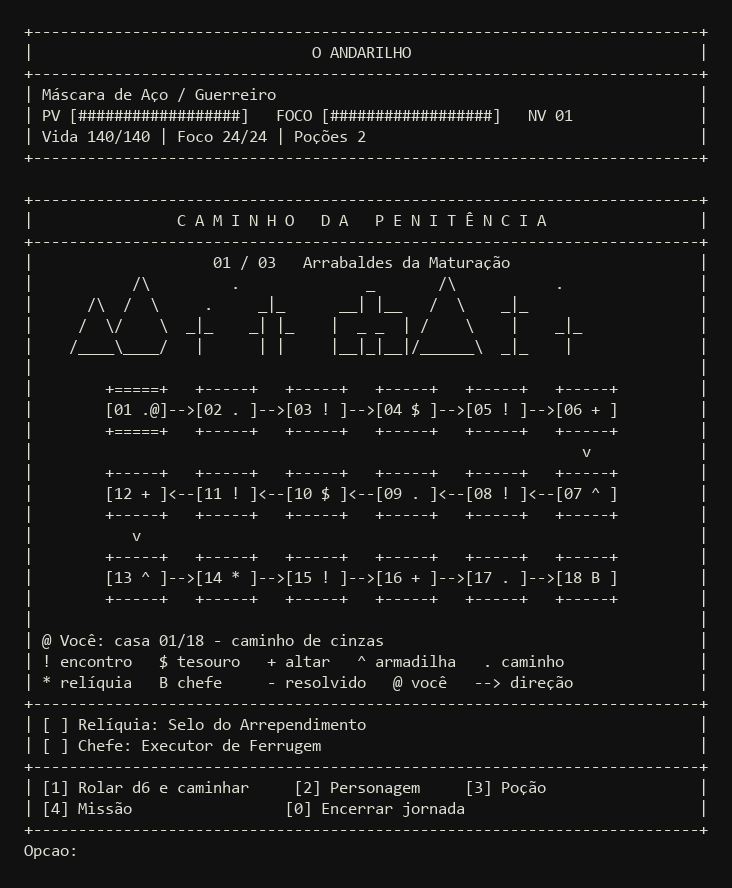
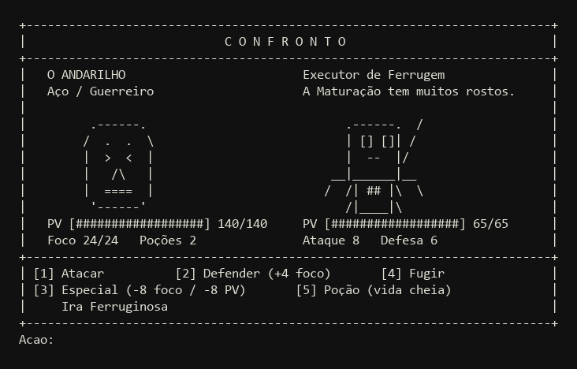

# Três Máscaras

RPG de tabuleiro para um jogador, inteiramente no terminal, escrito em **C99**.

A interface usa arte ASCII original, com inspiração na apresentação de [Candy Box](https://candybox2.github.io/): máscaras desenhadas com caracteres, mapas conectados, paisagens por fase e duelos com retratos. A ambientação permanece a de Cinderália.





As prévias acima são renderizações da saída real em texto. A cor e a fonte durante o jogo seguem a configuração do seu terminal.

**Aluno:** [preencher nome]  
**Matrícula:** [preencher matrícula]  
**Disciplina:** DCT1106 - Programação, 2026.2  
**Vídeo:** ainda não gravado/publicado; ver [roteiro](video/roteiro.md) e [campo para o link](video/link_video.md).

## Jogar no Windows

O pacote inclui `tres_mascaras.exe`, compilado para Windows de 64 bits. Extraia o ZIP e abra `jogar.cmd`, ou execute no PowerShell, dentro desta pasta:

```powershell
.\tres_mascaras.exe
```

O executável não precisa de Python, de rede ou de bibliotecas externas. Para recompilar, é necessário GCC com suporte a C99.

### Ritmo da narrativa e acentuação

A rolagem, o acontecimento da casa e o retorno ao mapa são apresentados em sequência, com pausas automáticas entre os blocos. Histórias de fase, encontros, ações, recompensas e a ficha também recebem tempo de leitura. O mapa e os menus aguardam sua escolha normalmente.

O cálculo considera as palavras e os sinais de pontuação do texto, sem contar molduras ou desenhos: no ritmo normal, `600 + 260 × palavras + 100 × pontuações` milissegundos, limitado entre 1,4 e 14 segundos. O ritmo rápido usa 40% desse tempo; o lento usa 150%. Na opção **[3] Ritmo da narrativa**, no menu principal, escolha Normal, Rápido, Lento ou Sem pausas.

Também é possível iniciar por argumentos:

```powershell
.\jogar.cmd --ritmo rapido
.\jogar.cmd --ritmo lento --seed 42
.\jogar.cmd --sem-pausas
```

As palavras e os nomes usam UTF-8 com acentuação completa, incluindo “Aço”, “poção”, “missão”, “força” e “Maturação”. O `jogar.cmd` configura a página de código UTF-8 do console e a restaura ao encerrar. Para executar o `.exe` diretamente no Windows, use `chcp 65001` antes. Os fontes também devem ser salvos em UTF-8; Makefile e script de compilação já definem essa codificação.

Para preservar a exigência de usar somente a biblioteca padrão C99, as pausas usam espera ativa com `clock()`, que pode ocupar um núcleo de CPU enquanto aguarda. O modo Sem pausas elimina essa espera. Não há dependência de `windows.h`, `unistd.h` ou de comandos de espera do sistema.

## Compilar a partir do código

### Windows com GCC/MinGW-w64

Com `gcc` disponível no PATH, abra o PowerShell nesta pasta:

```powershell
chcp 65001
gcc -std=c99 -Wall -Wextra -Wpedantic -finput-charset=UTF-8 -fexec-charset=UTF-8 -O2 -Isrc src/main.c src/interface.c src/personagem.c src/combate.c src/tabuleiro.c -o tres_mascaras.exe
.\tres_mascaras.exe
```

Também há `compilar.ps1`. Se a política local permitir scripts, execute `./compilar.ps1`; o comando GCC acima funciona sem alterar essa política. Uma distribuição portátil de GCC é o [w64devkit](https://github.com/skeeto/w64devkit): abra seu terminal na pasta do projeto ou informe o caminho completo de `gcc.exe`.

### Linux e macOS

Pré-requisito: GCC ou compilador C compatível com C99. No macOS, o comando `gcc` também pode corresponder ao Apple Clang.

```sh
gcc -std=c99 -Wall -Wextra -Wpedantic -finput-charset=UTF-8 -fexec-charset=UTF-8 -O2 -Isrc src/main.c src/interface.c src/personagem.c src/combate.c src/tabuleiro.c -o tres_mascaras
./tres_mascaras
```

Com GNU Make e o compilador disponíveis:

```sh
make
./tres_mascaras
```

No Windows, o nome gerado por `make` é `tres_mascaras.exe`. O código foi compilado e executado em Windows x64; Linux e macOS recebem os comandos para o mesmo código C99 portátil, mas não foram executados nesta entrega.

### Repetir uma partida

```powershell
.\tres_mascaras.exe --seed 42
.\tres_mascaras.exe --help
```

Sem `--seed`, `srand((unsigned int)time(NULL))` inicializa a aleatoriedade. A mesma semente e a mesma sequência de ações reproduzem a partida no mesmo executável. A sequência de `rand()` pode variar entre bibliotecas C e sistemas.

## História

Em Cinderália, os pecados não morrem com a carne. Cobiça, ira, covardia e vaidade tornam-se criaturas físicas por um processo chamado **Maturação**. Sobre os escombros surgiu **A Providência**, uma entidade que oferece cura em troca de adoração enquanto se alimenta do sofrimento de seus devotos.

O Andarilho, sem nome e marcado pelos erros do passado, atravessa esse mundo para revelar a falsa divindade. Três relíquias mascaradas guardam as memórias de antigos pecadores. Cada uma representa um personagem jogável distinto: o executor, o eclesiástico e a caçadora. A máscara escolhida no início permanece durante toda a campanha.

A ambientação e as três máscaras seguem o documento de história fornecido. Os números de atributos, monstros, cenários, missões e regras de equilíbrio foram definidos para esta implementação.

## Personagens

Todos começam no nível 1, sem XP, com duas poções e bônus de arma +2. Vida e foco começam cheios.

| Máscara / classe | Vida | Força | Defesa base | Agilidade | Inteligência | Foco |
|---|---:|---:|---:|---:|---:|---:|
| Aço / Guerreiro | 140 | 14 | 7 | 4 | 4 | 24 |
| Cinzas / Mago | 100 | 4 | 4 | 7 | 16 | 32 |
| Mortalha / Arqueiro | 115 | 7 | 6 | 14 | 8 | 24 |

| Máscara | Memória e aparência | Arma | Armadura | Bônus de armadura |
|---|---|---|---|---:|
| Aço | Executor arrependido; rosto de aço bruto tomado pela ferrugem | Montante de Ferro Batido | Placas Suplicantes | +3 |
| Cinzas | Eclesiástico que viu seu templo arder; madeira negra marcada pelo pranto | Incensário dos Finados | Manto Tenebroso | +2 |
| Mortalha | Caçadora que traiu seu povo; tecido funerário, ossos e olhos vendados | Besta de Ossos Santos | Manto de Sarapilheira | +2 |

### Habilidades próprias

Todas gastam **8 de foco**, lançam um d20 e consomem um turno quando utilizadas com sucesso.

| Habilidade | Efeito |
|---|---|
| Ira Ferruginosa (Aço) | Sacrifica 8 de vida e causa `max(1, d20 + 2 × força + arma + 8 - defesa inimiga)`. Exige vida maior que 8, impedindo suicídio pelo custo. |
| Chama das Lamentações (Cinzas) | Causa `d20 + 2 × inteligência + arma`, ignorando completamente a defesa inimiga. |
| Virote da Condenação (Mortalha) | Causa `2 × max(1, d20 + agilidade + arma - defesa inimiga)` e aplica sangramento de 4 de dano antes de cada uma das próximas três reações inimigas. Reaplicar renova a duração para três; não acumula pilhas. |

A habilidade de Aço e a de Cinzas não recebem outro multiplicador de crítico. O Virote já possui dano dobrado garantido. A Mortalha também tem crítico mais frequente em ataques comuns.

## Fases, monstros e missões

Cada fase possui dois monstros comuns e um chefe próprio, totalizando **nove monstros distintos**. Vida, ataque e defesa de cada categoria aumentam a cada fase.

| Fase | Missão principal |
|---|---|
| 1. Arrabaldes da Maturação | Obter o Selo do Arrependimento e derrotar o Executor de Ferrugem. |
| 2. Claustro das Lamentações | Recuperar a Brasa da Memória e vencer o Prior das Cinzas. |
| 3. Catedral do Falso Absoluto | Revelar a Verdade sem Véu e derrotar A Providência. |

| Fase | Monstro | Característica | Vida | Ataque | Defesa | Nível | XP |
|---:|---|---|---:|---:|---:|---:|---:|
| 1 | Devoto Oco | Covardia transformada em uma prece sem fim | 30 | 4 | 3 | 1 | 20 |
| 1 | Fera de Ossos | Ira em ossos entrelaçados | 38 | 6 | 4 | 1 | 25 |
| 1 | Executor de Ferrugem (chefe) | Carrasco da falsa fé | 65 | 8 | 6 | 2 | 45 |
| 2 | Avaro de Ferro | Cobiça convertida em pele metálica | 48 | 8 | 7 | 2 | 35 |
| 2 | Cantora Enlutada | Vaidade envolta em cera e lamentos | 55 | 9 | 6 | 2 | 40 |
| 2 | Prior das Cinzas (chefe) | Guardião dos falsos dogmas | 90 | 11 | 9 | 3 | 65 |
| 3 | Anjo de Cera | Promessa de salvação que aprisiona os fiéis | 65 | 11 | 10 | 3 | 50 |
| 3 | Bispo do Desespero | Adoração transformada em correntes | 75 | 12 | 11 | 3 | 55 |
| 3 | A Providência (chefe) | A Maturação oculta sob ouro e luz | 125 | 14 | 13 | 4 | 100 |

Os inimigos comuns são sorteados entre os dois tipos da fase. Não é obrigatório encontrar ambos na mesma partida. O terceiro tipo é sempre o chefe na última casa.

## Dinâmica do tabuleiro

Cada fase é um vetor de 18 casas. O personagem começa na casa 1 e lança `rand() % 6 + 1` para avançar. Apenas a casa de destino dispara um evento, com a parada obrigatória na casa de missão ao cruzá-la. Passos excedentes dessa parada são descartados. A casa final limita a movimentação.

| Casas (numeração exibida) | Evento |
|---|---|
| 1, 2, 9 e 17 | Vazia |
| 3, 5, 8, 11 e 15 | Combate comum |
| 4 e 10 | Tesouro: uma poção e um bônus aleatório de atributo |
| 6, 12 e 16 | Altar: cura `25 + 5 × fase` e recupera até 8 de foco |
| 7 e 13 | Armadilha: perde `d6 + 2 × fase` de vida |
| 14 | Missão: obtém a relíquia, cura até 15 de vida e recupera até 8 de foco |
| 18 | Chefe da fase |

O mapa forma uma trilha em serpentina: casas 1 a 6 da esquerda para a direita, 7 a 12 da direita para a esquerda, e 13 a 18 novamente para a direita. Setas ligam as casas na ordem de movimento. As bordas `+=====+` e o marcador `@` destacam a posição atual. Índices internos em C começam em zero: a casa 14 corresponde ao índice 13.

| Símbolo no mapa | Significado |
|---|---|
| `@` | Andarilho na casa atual |
| `.` | Caminho vazio |
| `!` | Encontro com monstro comum |
| `$` | Tesouro |
| `+` | Altar de cura |
| `^` | Armadilha |
| `*` | Relíquia da missão |
| `B` | Chefe |
| `-` | Evento já resolvido |

Cada fase tem uma paisagem própria: os arrabaldes, o claustro e a catedral. O painel superior mostra vida, foco, nível e poções. O combate exibe as máscaras e os nove monstros com retratos ASCII, barras de vida e indicações de recursos indisponíveis. Os textos de história quebram em palavras dentro de molduras de 76 colunas; recomenda-se um terminal com pelo menos 80 colunas e fonte monoespaçada. Para visualizar o mapa inteiro sem rolar, use cerca de 42 linhas de altura.

Cada evento não vazio é resolvido uma vez; vitórias encerram aquela casa de combate. Fugir não resolve a casa nem fornece recompensa. Ao fugir do chefe, o jogador recua à casa 17 e pode rolar novamente para reencontrá-lo, com vida cheia. Não existe bloqueio no fim do tabuleiro.

A próxima fase só abre quando **a relíquia foi obtida e o chefe foi derrotado**. Entre fases, vida e foco são restaurados e o estoque sobe para pelo menos duas poções, preservando um estoque maior. Eventos de cura nunca ultrapassam os máximos.

## Combate por turnos

O jogador age primeiro. Se o monstro continuar vivo, recebe o sangramento, quando presente, e então contra-ataca se ainda estiver vivo. Não existe ataque de um monstro já derrotado.

| Ação | Regra |
|---|---|
| 1. Atacar | Lança d20, soma atributo da classe e bônus da arma; desconta defesa do inimigo. |
| 2. Defender | Recupera até 4 de foco e recebe metade do próximo dano, arredondado para cima. Dura apenas essa reação. |
| 3. Especial | Executa a habilidade da máscara, se houver recursos suficientes. |
| 4. Fugir | Sucesso se `d20 + agilidade >= 20`. Sucesso encerra o combate sem XP ou bônus; falha permite a reação inimiga. Também é permitido fugir de chefes. |
| 5. Poção | Consome uma poção e cura até 35 de vida. O monstro pode reagir. |

Selecionar especial sem foco/vida suficientes ou poção indisponível/com vida cheia pede outra ação e **não consome turno**. Letras, números fora do menu, linhas vazias e entradas longas também são rejeitados sem realizar uma ação.

### Fórmulas de ataque

```text
atributo = força (Aço), inteligência (Cinzas), agilidade (Mortalha)
ataque do herói = d20 + atributo + bônus da arma
dano comum = max(1, ataque do herói - defesa do monstro)
crítico comum = dano comum × 2

ataque do monstro = d20 + ataque base
defesa total do herói = defesa base + bônus de armadura
dano recebido = max(1, ataque do monstro - defesa total do herói)
dano enquanto defendendo = (dano recebido + 1) / 2, com divisão inteira
```

Aço e Cinzas obtêm crítico comum apenas no 20 natural (5% dos resultados do d20). Mortalha obtém em 18, 19 ou 20 (15%). Não há teste separado de erro ou esquiva: um ataque comum sempre causa pelo menos 1 de dano. Especiais seguem suas próprias fórmulas.

## XP e evolução

Toda vitória concede o XP definido pelo monstro e **um** bônus sorteado uniformemente entre força +1, defesa +1, agilidade +1, inteligência +1 ou vida máxima +5 com cura de até 5. Tesouros concedem esse mesmo bônus, além da poção.

O custo do próximo nível é `40 × nível atual`. O XP gasto é descontado e o excedente é preservado. Há também um contador de XP total recebido. Cada nível dá:

- Vida máxima +12 e cura de até 20 de vida.
- Força, defesa, agilidade e inteligência +1 cada.
- Foco máximo +3 e foco restaurado.

As alterações são feitas por funções que recebem ponteiros, como `receberDano(Personagem *p, ...)`, `ganharXP(Personagem *p, ...)` e `danoNoMonstro(Monstro *m, ...)`.

## Vitória, derrota e saída

Concluir as três missões resulta em vitória e no encerramento da história. Vida zero, inclusive em armadilhas, resulta em derrota. O resumo mostra atributos, nível, XP total e combates vencidos. Depois, é possível iniciar outra jornada no menu.

O menu do tabuleiro permite encerrar a partida. EOF também encerra com segurança em qualquer leitura. O jogo mantém tudo em memória, sem salvar progresso, acessar a rede, limpar o terminal ou executar comandos do sistema. A arte usa caracteres ASCII e os textos usam português em UTF-8. As molduras contam letras visíveis, preservando o alinhamento mesmo quando uma letra acentuada ocupa mais de um byte.

## Organização e conceitos de C

```text
src/
  tipos.h            structs, enums e constantes
  main.c             argumentos, escolha da máscara e menu principal
  interface.c/.h     entrada validada e apresentação do jogo
  personagem.c/.h    criação, vida, foco, poções, XP e atributos
  combate.c/.h       dados, ataques, habilidades, fuga e recompensas
  tabuleiro.c/.h     fases, monstros, movimentação, eventos e campanha
tests/
  test_core.c        verificações das regras e limites
  test_integration.py  partidas e entradas pelo terminal
docs/
  GUIA_DO_CODIGO.md   explicação para estudo e apresentação
  ENTREGA.md         conferência dos requisitos e etapas pessoais
  VALIDACAO.md       comandos e resultados dos testes
video/
  roteiro.md         roteiro de gravação com até 10 minutos
  link_video.md      campo para o link real após gravar
Makefile
compilar.ps1
jogar.cmd
```

`Personagem`, `Monstro`, `Casa` e `Fase` são `struct`. Classe, tipo de casa, ação, resultado de combate e resultado da campanha usam `enum`. O tabuleiro e os modelos de monstros usam vetores. As funções de alteração recebem ponteiros e modificam a memória original, sem retornar uma cópia para sobrescrever na `main`.

O código do jogo inclui somente `stdio.h`, `stdlib.h`, `string.h` e `time.h`; não necessita de `math.h` ou de bibliotecas externas. Todos os desenhos do jogo são feitos com caracteres ASCII. As imagens deste README apenas ilustram a interface e não são necessárias para jogar.

## Testar

Com GNU Make e GCC:

```sh
make test
```

Sem Make, no PowerShell:

```powershell
chcp 65001
gcc -std=c99 -Wall -Wextra -Wpedantic -finput-charset=UTF-8 -fexec-charset=UTF-8 -Werror -O2 -Isrc tests/test_core.c src/interface.c src/personagem.c src/combate.c src/tabuleiro.c -o testes.exe
.\testes.exe
```

Opcionalmente, com Python 3.9 ou superior, teste também o fluxo real de terminal:

```powershell
python tests/test_integration.py .\tres_mascaras.exe
```

No Linux/macOS, compile os testes com `-o testes`, execute `./testes` e use `python3 tests/test_integration.py ./tres_mascaras`. Python serve apenas aos testes; não é dependência do jogo.

Os resultados desta entrega estão em [Validação](docs/VALIDACAO.md). Veja o [guia do código](docs/GUIA_DO_CODIGO.md) para acompanhar o funcionamento antes de apresentar.

